# Data Model — Fase 1

**Feature**: `001-preprocesamiento-analisis-home-office`

## Flujo de datasets

```mermaid
flowchart LR
    A[data/ec1_homeoffice/homeoffice_ml_crudo.csv<br/>3 680 × 17 · inicial] --> B[01 ingesta y limpieza]
    C[data/crudos/mercadolibre_raw.csv<br/>5 080 × 13 · inicial] --> B
    B --> D[data/intermedio/01_homeoffice_limpio.csv<br/>data/intermedio/01_categorias_limpio.csv]
    D --> E[02 faltantes y atípicos]
    E --> F[data/intermedio/02_homeoffice_tratado.csv]
    F --> G[03 integración y reducción]
    D --> G
    G --> H[data/intermedio/03_homeoffice_integrado.csv]
    H --> I[04 transformación e ingeniería de características]
    I --> J[data/final/homeoffice_final.csv]
    J --> K[(data/final/home_office.sqlite)]
    K --> L[05 análisis y visualización]
    L --> M[data/final/metricas.json<br/>docs/parte_2/figuras/]
    B & E & G --> N[data/evidencia/*.csv]
```

Los archivos de `data/crudos/` y `data/ec1_homeoffice/homeoffice_ml_crudo.csv` son de solo lectura.

## Entidad Publicación — `data/final/homeoffice_final.csv`

Una fila por oferta de componente de home office. Clave: `id_oferta`.

| Variable | Tipo | Regla / origen | Nulos permitidos |
| --- | --- | --- | --- |
| `id_oferta` | texto | R1: `wid` → ruta directa → catálogo | No; único |
| `id_catalogo` | texto | código `/p/MPE…` o código de la Parte I | No |
| `componente` | categórico | búsqueda de origen normalizada: laptop, monitor, silla, teclado, mouse, audifonos | No |
| `titulo` | texto | espacios normalizados | No |
| `marca` | categórico | diccionario de marcas por componente sobre el título; `otra` si no se reconoce | No |
| `precio` | decimal, S/ | texto peruano → número; > 0 | No |
| `log_precio` | decimal | `log10(precio)` | No |
| `precio_relativo` | decimal, desviaciones estándar | Z-score de `log_precio` dentro del componente | No |
| `precio_anterior` | decimal, S/ | texto → número; > `precio` | Sí: sin promoción (estructural) |
| `tiene_descuento` | booleano | precio anterior presente y mayor que el precio | No |
| `descuento_pct` | decimal, % | `(precio_anterior − precio) / precio_anterior × 100`; 0 sin promoción | No |
| `descuento_anunciado_pct` | entero, % | texto "NN% OFF" | Sí: sin promoción |
| `descuento_inflado` | booleano | descuento anunciado > calculado en más de 1,5 puntos | No |
| `ofrece_cuotas` | booleano | texto de cuotas presente | No |
| `numero_cuotas` | entero | texto de cuotas | Sí: no ofrece cuotas (estructural) |
| `monto_cuota` | decimal, S/ | texto de cuotas | Sí: no ofrece cuotas (estructural) |
| `tiene_resenas` | booleano | texto de reseñas presente | No |
| `calificacion` | decimal 1–5 | texto de reseñas | Sí: MAR, sin imputar |
| `vendidos_min` | entero | "+N vendidos" → N (cota inferior) | Sí: MAR, sin imputar |
| `envio` | categórico | gratis mañana / gratis / mañana con costo / no informado | No |
| `envio_gratis` | booleano | `envio` empieza con gratis | No |
| `entrega_manana` | booleano | `envio` contiene mañana | No |
| `vendedor_visible` | booleano | texto de vendedor presente | No |
| `vendedor` | categórico | nombre de tienda; `no informado` si falta | No |
| `tienda_de_marca` | booleano | el nombre de la tienda contiene la marca | No |
| `es_publicidad` | booleano | URL de anuncio patrocinado (redirección mclics) | No |
| `es_gamer` | booleano | el título contiene "gamer" o "gaming" | No |
| `ram_gb` | entero | título (solo laptop) | Sí: no aplica a otros componentes |
| `almacenamiento_gb` | entero | título (solo laptop) | Sí: no aplica |
| `pulgadas` | decimal | título (solo monitor) | Sí: no aplica |
| `inalambrico` | booleano | título (teclado, mouse, audífonos) | Sí: no aplica |
| `ergonomica` | booleano | título (silla) | Sí: no aplica |
| `gama` | ordinal | R5: terciles de precio por componente — económica < media < alta | No |
| `atipico_precio` | booleano | R3: univariado sobre log-precio, conservado por plausible | No |
| `en_ambas_capturas` | booleano | R6: la oferta figura también en categorías | No |
| `precio_13_09` | decimal, S/ | R6: precio en la captura de categorías | Sí: solo presente en ambas capturas |
| `variacion_precio_pct` | decimal, % | R6: `(precio − precio_13_09) / precio_13_09 × 100` | Sí: solo presente en ambas |
| `pagina`, `posicion_pagina` | entero | metadatos de la captura | No |
| `url_publicacion` | texto | URL original | No |
| `fecha_extraccion` | fecha y hora | `AAAA-MM-DD HH:MM:SS`, sin zona horaria | No |

Los nulos "no aplica" o estructurales son la justificación que SC-005 exige para columnas con más de 10 % de
faltantes; el diccionario final los declara así.

**Desviación respecto del diseño inicial**: `sobrecosto_cuotas_pct` se descartó porque todas las cuotas
observadas son sin interés (`numero_cuotas × monto_cuota ≈ precio`), así que la variable sería constante.

**Invariantes** (verificados con `assert` en cada etapa):

- `id_oferta` único y sin nulos; `precio > 0`; `0 ≤ descuento_pct < 100`; `1 ≤ calificacion ≤ 5`.
- `tiene_descuento ⇔ precio_anterior` no nulo; `ofrece_cuotas ⇔ numero_cuotas` no nulo.
- Cada publicación pertenece a exactamente una `gama`.
- Balance por etapa: filas de entrada = filas de salida + filas en `data/evidencia/` de esa etapa.

## Entidad Registro excluido — `data/evidencia/`

| Archivo | Etapa | Contenido |
| --- | --- | --- |
| `01_duplicados.csv` | 01 | ofertas repetidas retiradas, con la observación conservada |
| `01_ajenas_al_componente.csv` | 01 | publicaciones que no son el componente buscado, con la regla que las detectó |
| `01_reasignadas.csv` | 01 | laptops aparecidas en búsquedas de periféricos, reasignadas a `laptop` (se conservan) |
| `01_inconsistencias.csv` | 01 | textos no interpretables o campos relacionados incoherentes (se conservan; solo se registran) |
| `02_correcciones.csv` | 02 | promociones con precio anterior ≤ precio, anuladas (se conservan sin promoción) |
| `02_atipicos.csv` | 02 | atípicos detectados, criterio y decisión (conservar / excluir) |
| `02_excluidos_por_error.csv` | 02 | atípicos excluidos por error comprobable, con su motivo |

Todos llevan las columnas `id_oferta`, `etapa`, `motivo` además de las del registro original.

## Entidades de análisis — `data/final/`

- **Precio por gama** (`precios_por_gama.csv`): `componente`, `gama`, `n`, `precio_min`, `q1`, `mediana`,
  `q3`, `precio_max`.
- **Perfil de home office** (`perfiles_home_office.csv`): `perfil` (económico, medio, alto), `costo_mediano`,
  `costo_q1`, `costo_q3`, y la contribución de cada componente.
- **Ofertas comunes** (`integracion_ofertas_comunes.csv`): `id_oferta`, `componente`, `precio_13_09`,
  `precio_15_09`, `variacion_precio_pct`.
- **Métricas** (`metricas.json`): toda cifra citada en el informe y la presentación.
- **Manifiesto** (`manifiesto.json`): filas, columnas y SHA-256 de cada CSV final.

## Almacén — `data/final/home_office.sqlite`

| Tabla | Fuente | Clave |
| --- | --- | --- |
| `publicaciones` | `homeoffice_final.csv` | `id_oferta` |
| `precios_por_gama` | `precios_por_gama.csv` | (`componente`, `gama`) |
| `perfiles` | `perfiles_home_office.csv` | `perfil` |
| `ofertas_comunes` | `integracion_ofertas_comunes.csv` | `id_oferta` |
| `excluidos` | unión de `data/evidencia/*.csv` | (`id_oferta`, `etapa`) |
